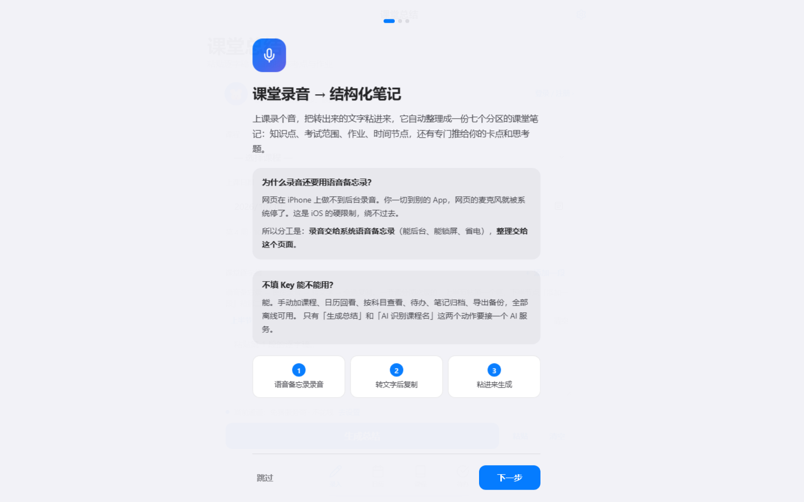

# 课堂总结 · Classnote

> 在手机或电脑上，把课程记录整理成可查找、可回顾的结构化笔记。

**[打开应用 →](https://ndshuge.github.io/ndshuge-classnote/)**



## 能做什么？

- **课程管理**：按课程整理记录，结合日历查看学习内容。
- **AI 辅助总结（可选）**：将已有的课堂转写文本粘贴进应用，按提示配置自己的 AI 服务后生成结构化总结。
- **离线基础功能**：不填写 AI Key 也能管理课程、待办、笔记与导出备份。
- **跨设备同步（可选）**：登录后使用应用提供的同步能力；游客数据保存在当前浏览器。
- **移动端体验**：响应式页面、深浅色主题、适配手机操作。

## 快速开始

1. 打开 [在线应用](https://ndshuge.github.io/ndshuge-classnote/)。
2. 按首次使用引导添加课程；不想接入 AI 可直接跳过密钥设置。
3. 需要总结课堂内容时，先用手机或电脑的录音/转写软件取得文字，再将文字粘贴到页面中。
4. 如要生成 AI 总结，请自行选择服务商、配置账号及 API Key。
5. 定期导出备份，尤其是在只使用游客模式时。

**注意：网页本身并不替代系统录音软件。** 录音与语音转文字通常需要先在系统或其他工具中完成。

## 隐私与数据

- 使用 AI 功能时，你提交的课堂文本会发送给所选 AI 服务商；请遵守学校、老师与同学的隐私要求。
- 账号、同步、密钥与本地缓存的安全性依赖应用实现和浏览器环境。不要在公共或不可信设备上保存密钥。
- 不要上传未经授权的课堂录音、含有他人个人信息的材料或保密资料。
- 若使用游客模式，清理浏览器站点数据可能导致本地记录丢失，请提前导出。

## 本地运行与结构

该仓库目前以 `index.html` 为前端入口，直接打开即可访问大部分界面。如果浏览器对 `file://` 存储或网络请求有限制，请启动一个本地静态服务器：

```bash
python -m http.server 8000
```

然后在浏览器中打开 `http://localhost:8000/`。部署使用 GitHub Pages。

## 反馈

欢迎通过 [Issues](https://github.com/ndshuge/ndshuge-classnote/issues) 反馈真实的复现步骤、浏览器与设备型号。提交反馈前请删除课堂原文、API Key 与账号信息。

代码/素材授权方式待维护者确认；公开可阅读不等于自动授予商用或改作许可。
